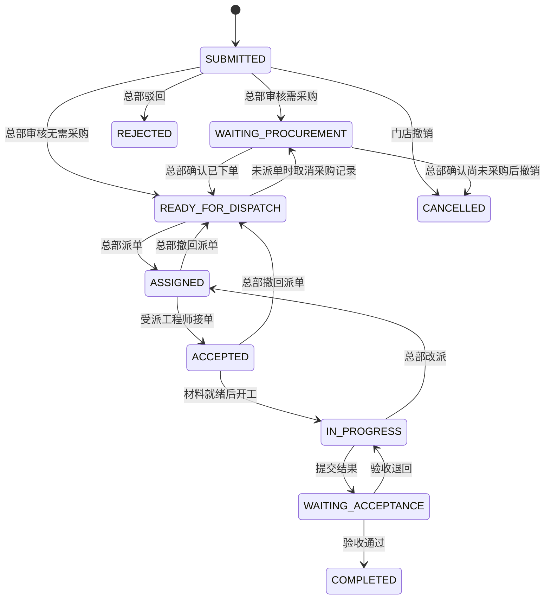

# 业务流程、角色与状态机

## 1. 业务模型

一个总部管理多家线下门店。门店设施可以是冷柜、空调、收银设备、照明、货架等。位置用“门店 + 店内区域”描述，不强制沿用校园的楼栋/教室。

工单同时区分三组数据：

| 数据 | 含义 | 来源 |
| --- | --- | --- |
| 原设施 | 门店已经发生故障的设施、品牌、型号、序列号 | 原台账，或门店填写后由总部核对 |
| 本次采购物品 | 为这次维修购买的配件或替换设备 | 总部订单及人工确认的 OCR 候选 |
| 维修结果 | 实际处理方式、结果、照片、费用及验收 | 工程师记录，门店/总部验收 |

订单截图里新买配件的型号不得覆盖原设施型号。维修完成不等于原设备必然恢复；替换场景应建立新资产并将旧资产标记为已替换。

## 2. 角色与数据范围

| 操作 | 门店管理员 STORE_MANAGER | 总部 HQ_ADMIN | 工程师 ENGINEER |
| --- | --- | --- | --- |
| 门店/设施列表 | 负责的门店 | 全部门店 | 仅任务所需的设施摘要 |
| 创建报修 | 负责的启用门店 | 不作为门店代提入口，一期由门店提交 | 不可 |
| 工单详情/时间线 | 负责门店的工单 | 全部 | 当前派给自己的工单 |
| 审核、驳回、确定是否采购 | 不可 | 可 | 不可 |
| 采购单、订单图、OCR、费用确认 | 不可；只看材料进度摘要 | 可 | 不可；只看所需材料名称/型号/到货与收货操作 |
| 派单、撤回、改派 | 不可 | 可 | 不可 |
| 接单、约时间、开工、提交结果 | 不可 | 不代替工程师执行 | 当前受派工程师 |
| 到货登记 | 本门店收货时可，不能改采购金额 | 可 | 当前任务的收货时可，不能改采购金额 |
| 验收、退回维修 | 负责门店可 | 可代办，原因必填 | 不可 |
| 汇总统计、费用、导出 | 本店进度/数量摘要，不含采购价格 | 全部及按门店筛选 | 自己任务数量/时效，不含订单截图和价格 |
| 邀请账号、分配门店、角色和停用 | 不可 | 可，保护最后一个有效总部管理员 | 不可 |

所有列表、数量、筛选项、附件、导出和时间线均执行同样的数据范围；不能只给详情加权限。工程师被改派后，旧处理人失去该工单读取权，操作历史保留。门店管理员授权变更后，按当前门店授权读取，不因曾经提交而继续读取其他门店数据。

“参与工单”不等于能看到采购隐私：订单截图、价格、订单号、供应商联系方式只对总部展示；门店/工程师只获得材料配送和维修必要信息。

账号仅邀请加入。总部可邀请门店管理员或工程师；总部权限变更通过单独受审计操作执行。首个总部管理员通过一次性的本地初始化命令创建，无默认公开密码、无公开提权 API。已停用成员不能登录/刷新，已签发 access token 在下一次工单 API 请求时也会被成员检查拒绝。

## 3. 工单状态

| 状态 | 含义 |
| --- | --- |
| SUBMITTED | 门店已提交，等待总部审核 |
| WAITING_PROCUREMENT | 总部确认需要采购，尚未完成下单记录 |
| READY_FOR_DISPATCH | 无需采购，或采购已经下单，可安排工程师 |
| ASSIGNED | 总部已派给工程师，等待接单 |
| ACCEPTED | 工程师已接单，可登记预计上门时间 |
| IN_PROGRESS | 材料条件满足，已开始维修 |
| WAITING_ACCEPTANCE | 工程师提交结果，等待门店验收 |
| COMPLETED | 门店/总部验收完成 |
| CANCELLED | 在允许阶段撤销报修 |
| REJECTED | 总部驳回申请，保留原因 |

活动工单为前七种状态；终态为 COMPLETED、CANCELLED、REJECTED。历史记录仍在同一主表，通过终态过滤查询，不搬表或删除。

## 4. 动作规则

| 动作 | 前置条件与行为 |
| --- | --- |
| 提交 | 门店、成员、分类有效；填写设施位置、故障描述和联系信息；已选资产必须属于该门店。可不选资产，但设施名称/区域必填；未知设施工单暂不做资产级去重 |
| 总部审核 | 仅 SUBMITTED；需采购时确定方案 PART_REPAIR 或 REPLACEMENT；无需采购走 REPAIR，不创建空采购单 |
| 驳回 | 仅 SUBMITTED，总部原因必填；终止活动资产占位，但不自动把设施设为正常 |
| 门店撤销 | 仅 SUBMITTED，本门店管理员原因必填 |
| 总部撤销 | 仅 WAITING_PROCUREMENT，且不存在已下单/到货的有效采购单；原因必填，草稿采购记录一并取消 |
| 标记已下单 | 采购草稿全部必需字段已经人工确认；数据库只记录线下/外部渠道采购事实，不向购物平台发请求 |
| 派单 | 仅 READY_FOR_DISPATCH；工程师启用；需要采购时，必须存在有效 ORDERED/PARTIALLY_RECEIVED/RECEIVED 采购单 |
| 接单 | 仅 ASSIGNED，当前受派工程师；接单不要求已到货 |
| 上门预约 | 仅 ACCEPTED/IN_PROGRESS，受派工程师登记未来或当前时间和简短说明；不开放聊天或留言流 |
| 开工 | 仅 ACCEPTED；无需采购，或有效采购单全部明细已收齐；否则 MATERIALS_NOT_READY，保持原状态 |
| 提交结果 | 仅 IN_PROGRESS；处理说明、结果照片至少 1 张；存在采购时采购不能被取消，材料完整到货；可填建议人工费用，不能自行修改总部确认金额 |
| 验收通过 | 仅 WAITING_ACCEPTANCE；本门店管理员或总部代验收；PART_REPAIR/REPAIR 恢复原设施，REPLACEMENT 建立新资产并退役旧资产 |
| 验收退回 | 仅 WAITING_ACCEPTANCE；原因必填，回到 IN_PROGRESS；既有维修记录不覆盖、不删除 |
| 撤回派单 | 仅 ASSIGNED/ACCEPTED，总部原因必填，清空当前处理人后回到 READY_FOR_DISPATCH |
| 改派 | 仅 IN_PROGRESS，总部必须填写原因；原子地更换处理人为新的 ASSIGNED，保留材料和既往记录，原工程师立即失去访问权 |
| 取消采购 | 仅订单未发生任何到货，且工单尚未派单；订单已下单时工单回到 WAITING_PROCUREMENT。已派单必须先撤回；已开工/有到货不提供普通取消入口 |

一期不提供终态工单直接重开、维修中普通取消、采购退货或维修后追加采购。遇到这些情况由总部登记业务说明后按明确扩展设计处理，不能用通用 PATCH 偷改状态。再次故障建立新工单，可关联历史工单号。

每次合法状态变化只产生一个 version 增量和一个事件；同一请求幂等重试不重复产生事件、费用、通知或替换资产。

## 5. 设施、门店与采购状态

设施分别记录 `lifecycle=ACTIVE/RETIRED` 和 `condition=NORMAL/FAULTY/REPAIRING`。提交已关联设施的报修后设 FAULTY，正式开工后设 REPAIRING；验收维修成功后才能恢复 NORMAL。驳回/取消不自动证明设施正常；总部须在无活动工单时填写原因单独校正。

替换设备流程：保留原资产及原快照，验收事务内创建新资产（来源为已确认采购明细，数量 1），原资产改为 RETIRED 并记录 replacedByAssetId。新资产继承门店和安装位置，品牌型号来自人工确认的采购项。一个工单一期最多有一个替换设备项，其余项只能是配件。

门店停用后不能提交新工单或新增资产；已存在的工单允许继续完成，相关门店授权保留。停用分类/资产不删除历史数据；有活动工单的设施不能被迁移到别的门店或手动退役。

采购状态为 `DRAFT → ORDERED → PARTIALLY_RECEIVED → RECEIVED`，可在规则允许时转 CANCELLED。材料就绪根据有效采购明细的实际到货数量推导，不使用“订单已下单”替代“材料已到货”。详见[采购与 OCR](05-procurement-and-ocr.md)。

## 6. 通知、超时与统计口径

站内通知与业务事务一起保存。默认首页每 30 秒轮询待办/未读数；一期不以 WebSocket 在线连接保证关键通知送达。邮件是可开关的辅助渠道，失败不回滚采购、派单或验收。

默认超时阈值为开发可配置值：审核 4 小时、接单 8 小时、维修完工 72 小时、验收 24 小时，按自然时长计算。审核从 submittedAt 起；接单从本次 assignedAt 起；维修从 firstStartedAt 到最近一次工程师完工时间（返修继续计时）；验收从最近 submittedForAcceptanceAt 起。采购等待时间单独统计，不算进首次开工后的维修耗时。超时只告警和标记，不自动采购、不自动验收、不自动扣款。

总部统计必须明确时间范围与门店筛选：

- 新报修数：submittedAt 落入范围的工单数；完成数：completedAt 落入范围的工单数。
- 未结数：查询时处于活动状态的工单数，不受“完成日期”过滤；页面明确这是当前存量。
- 完成率：同一 submittedAt 范围的工单中已完成数 / 同一范围提交数，分母为 0 时返回 null，不混用当日完成数和当日提交数。
- 平均维修耗时：完成工单的 completedRepairAt - firstStartedAt；平均全流程耗时：completedAt - submittedAt，均说明样本按 completedAt 范围选取。
- 到货耗时：最后收齐时间 - orderedAt；统计有效已收齐采购单。
- 采购支出：有效已下单采购单的 confirmedTotal，按 orderedAt 范围；只是记录的采购金额，不宣称已付款/已结算。
- 完成工单总费用：确认采购金额 + 总部确认人工费用 + 总部确认其他费用，按 completedAt 范围；未确认费用标记为 pending，不用 0 伪装成已核算。
- 品牌/型号故障分析按原设施快照统计，采购物品排行按采购明细统计；两者不得混在一张维度表里。

统计查询只读，不触发状态修复、通知发送或批量写入。CSV 导出沿用同一筛选、权限与口径，最大 10,000 行，一期同步流式导出，超过上限要求缩小范围。
